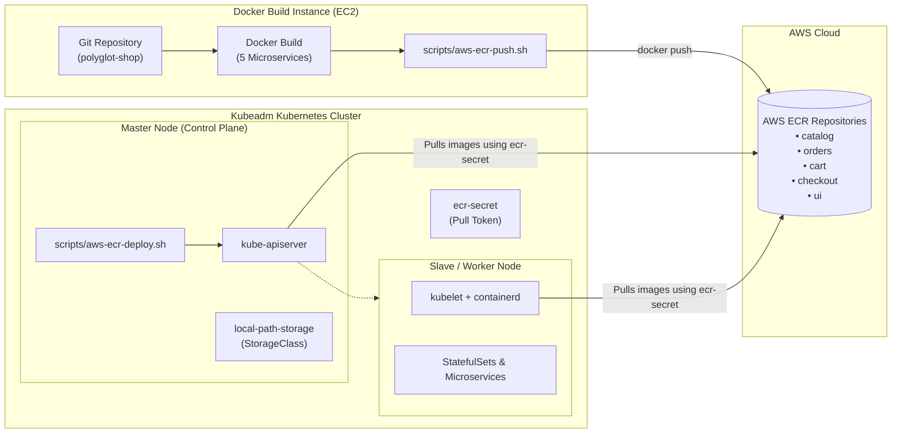

# 🛍️ AWS ECR + Kubeadm Cluster Deployment Guide

This guide details the complete workflow for building, pushing, deploying, and managing the **Polyglot Retail Store** application across AWS instances:
- **Build Instance**: An AWS EC2 VM where Docker is installed and the repository is cloned.
- **Container Registry / Artifactory**: Amazon Elastic Container Registry (AWS ECR).
- **Kubernetes Cluster**: A 2-node **kubeadm** cluster (1 Master Node + 1 Slave/Worker Node) on AWS.

---

## 📐 Architecture & Workflow



---

## 📋 Prerequisites

### 1. On the Docker Build Instance
- **Docker** installed and running:
  ```bash
  docker --version
  ```
- **AWS CLI** v2 installed and configured with credentials that have ECR permissions (`AmazonEC2ContainerRegistryPowerUser` or FullAccess):
  ```bash
  aws configure
  # Check identity:
  aws sts get-caller-identity
  ```

### 2. On the Kubeadm Master Node
- **kubectl** installed and cluster healthy:
  ```bash
  kubectl get nodes -o wide
  # Should show both Master and Slave nodes in 'Ready' status
  ```
- **AWS CLI** installed and configured (needed to generate temporary ECR authentication tokens for `kubectl`).
- **EC2 Security Group**:
  - Inbound rule for UI NodePort: Port range `30000-32767` from your IP or `0.0.0.0/0`.
  - Inbound rules between Master and Slave for internal pod networking (e.g. Flannel / Calico CNI ports, Kubelet `10250`, etc.).

---

## 🚀 Step-by-Step Deployment

### Step 1: Build & Push Images to AWS ECR

Run this step on your **Docker Build Instance**:

1. Clone or navigate to the repository:
   ```bash
   cd polyglot-shop-k8s-cicd
   ```

2. Make the script executable:
   ```bash
   chmod +x scripts/aws-ecr-push.sh
   ```

3. Run the script:
   ```bash
   ./scripts/aws-ecr-push.sh <AWS_ACCOUNT_ID> <AWS_REGION> [IMAGE_TAG]
   ```
   *Example:*
   ```bash
   ./scripts/aws-ecr-push.sh 517178430929 eu-north-1 latest
   ```
   *(If you omit arguments, the script will automatically detect or prompt for them).*

#### What the script handles automatically:
- Tests Docker and AWS CLI connectivity.
- Authenticates Docker to your AWS ECR endpoint (`<account>.dkr.ecr.<region>.amazonaws.com`).
- Creates any missing ECR repositories (`catalog`, `orders`, `cart`, `checkout`, `ui`) with AES-256 encryption.
- Applies the numeric `chown` permissions patch on `checkout/Dockerfile` to avoid builder errors.
- Builds all 5 service images and pushes them to AWS ECR.

---

### Step 2: Deploy to Kubeadm Kubernetes Cluster

Run this step on your **Kubeadm Master Node**:

1. Clone or copy the repository onto the Master Node:
   ```bash
   git clone https://github.com/Darshan9154/polyglot-shop-k8s-cicd.git
   cd polyglot-shop-k8s-cicd
   ```

2. Make the script executable:
   ```bash
   chmod +x scripts/aws-ecr-deploy.sh
   ```

3. Run the deployment script:
   ```bash
   ./scripts/aws-ecr-deploy.sh <AWS_ACCOUNT_ID> <AWS_REGION> [IMAGE_TAG]
   ```
   *Example:*
   ```bash
   ./scripts/aws-ecr-deploy.sh 517178430929 eu-north-1 latest
   ```

#### What happens during deployment:
1. **Dynamic Storage Provisioner**: Installs Rancher `local-path-provisioner` if your kubeadm cluster does not yet have a default StorageClass. This enables PVs and PVCs for the databases (PostgreSQL, MariaDB, Redis, RabbitMQ).
2. **Namespace Creation**: Ensures namespace `retail-store` exists.
3. **ECR Authentication Secret (`ecr-secret`)**: Fetches a fresh auth token from AWS ECR and creates a `docker-registry` secret in `retail-store`.
4. **ServiceAccount Patching**: Patches the `default` ServiceAccount with `imagePullSecrets: ecr-secret` so that **both Master and Slave nodes** can pull the private ECR images without manual manifest edits.
5. **Database & Queue Deployment**: Applies manifests for RabbitMQ, PostgreSQL (`orders-db`), Redis (`checkout-redis`), MariaDB (`catalog-db`), and DynamoDB-Local (`carts-db`).
6. **Microservices Deployment**: Applies deployments for `catalog`, `orders`, `cart`, `checkout`, and `ui`, dynamically substituting the AWS ECR image URI.
7. **Service Exposure**: Queries the UI service's `NodePort` and the node's public IP.

---

## 🌐 Verifying the Deployment & Accessing the App

### 1. Check Pod Status across Nodes
```bash
kubectl -n retail-store get pods -o wide
```
You will see pods distributed between your Master and Slave/Worker nodes:
```text
NAME                              READY   STATUS    NODE
catalog-5df5b56469-xxxxx          1/1     Running   ip-172-31-xx-xx (worker)
catalog-db-0                      1/1     Running   ip-172-31-xx-xx (worker)
checkout-64ff89658b-xxxxx         1/1     Running   ip-172-31-xx-xx (worker)
checkout-redis-0                  1/1     Running   ip-172-31-xx-xx (worker)
orders-76c8c97fc7-xxxxx           1/1     Running   ip-172-31-xx-xx (worker)
orders-db-0                       1/1     Running   ip-172-31-xx-xx (worker)
rabbitmq-0                        1/1     Running   ip-172-31-xx-xx (worker)
ui-7bd45dbd4d-xxxxx               1/1     Running   ip-172-31-xx-xx (worker)
```

### 2. Check the UI Service & NodePort
```bash
kubectl -n retail-store get svc ui
```
Output will look similar to:
```text
NAME   TYPE       CLUSTER-IP      EXTERNAL-IP   PORT(S)          AGE
ui     NodePort   10.108.95.228   <none>        8080:31234/TCP   5m
```

### 3. Open in Browser
Open your browser and navigate to:
```text
http://<MASTER_OR_WORKER_PUBLIC_IP>:<NODEPORT>
```
*(For example: `http://13.49.245.123:31234`)*

---

## 🗑️ Managing & Deleting Images from AWS ECR

When you want to remove old builds, clean up untagged layers to save AWS storage fees, or delete repositories, use `scripts/aws-ecr-delete.sh`.

### Interactive Mode:
```bash
chmod +x scripts/aws-ecr-delete.sh
./scripts/aws-ecr-delete.sh
```
This presents a menu:
1. **Delete a specific tag** (e.g. `latest` or `v1.0.0`) across all 5 repositories.
2. **Delete untagged / orphaned images** (cleans up dangling layers).
3. **Delete all images** across all 5 service repositories (empties the repositories).
4. **Delete the 5 ECR repositories completely** (`--force`).

### Automated CLI Options:
```bash
# Preview deletion without deleting (Safe Dry Run)
./scripts/aws-ecr-delete.sh --account 517178430929 --region eu-north-1 --tag latest --dry-run

# Delete only untagged dangling images (frees up AWS storage)
./scripts/aws-ecr-delete.sh --account 517178430929 --region eu-north-1 --untagged

# Delete all images from the repositories (empty repos)
./scripts/aws-ecr-delete.sh --account 517178430929 --region eu-north-1 --all-images --force

# Delete the ECR repositories themselves
./scripts/aws-ecr-delete.sh --account 517178430929 --region eu-north-1 --delete-repos --force
```

---

## 🧹 Deleting the Kubernetes Deployment

To remove all deployed resources from your Kubeadm cluster:
```bash
kubectl delete namespace retail-store
```
This removes all deployments, StatefulSets, secrets, and services cleanly.

---

## 🛠️ Common Troubleshooting

| Issue | Cause | Solution |
| :--- | :--- | :--- |
| `ImagePullBackOff` or `ErrImagePull` on Slave node | Worker node cannot authenticate to private AWS ECR | Ensure `scripts/aws-ecr-deploy.sh` was run on the Master node (it patches `serviceaccount default` with `ecr-secret`). Note that ECR tokens expire after 12 hours. Re-run `./scripts/aws-ecr-deploy.sh` to refresh the token. |
| Database pods stuck in `Pending` | Missing PersistentVolume / StorageClass | The script automatically installs Rancher's `local-path` provisioner. Run `kubectl get storageclass` to verify `local-path (default)` is listed. |
| Cannot access UI via browser | AWS EC2 Security Group blocking NodePort | In AWS Console > EC2 > Security Groups, add an Inbound Rule allowing TCP port `30000-32767` from your IP. |
| `RepositoryNotFoundException` during push | ECR repository does not exist in target region | `scripts/aws-ecr-push.sh` automatically creates repositories; ensure your IAM user has `ecr:CreateRepository` permission. |
